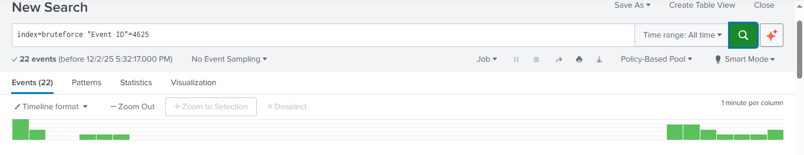
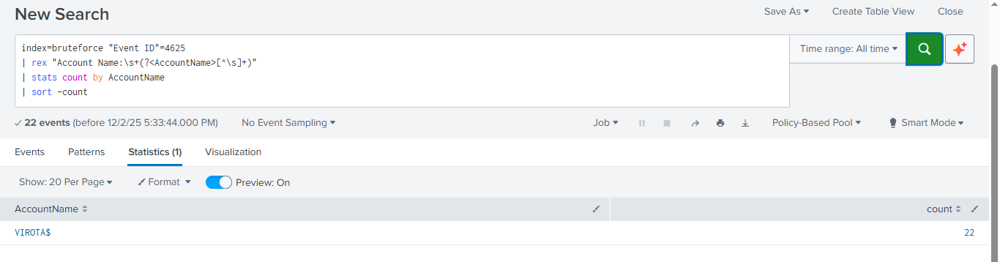
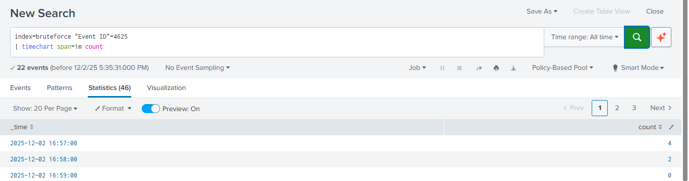
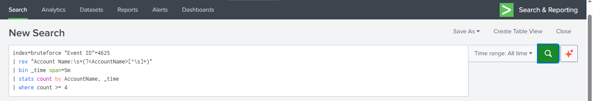
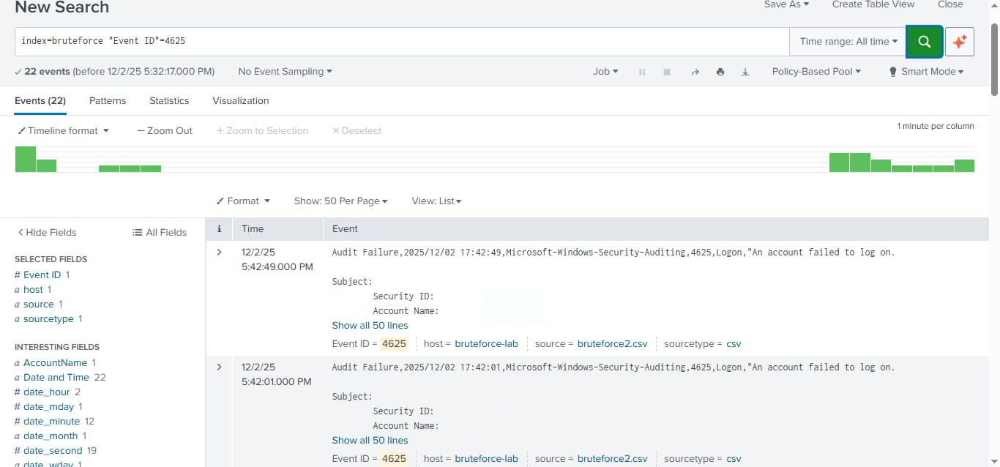

# splunk-bruteforce-detection
Windows Brute-Force Detection Using Splunk SIEM
# Project Overview
> ⚠️ All identifiers (usernames, hostnames and IP addresses) and screenshots have been sanitised.
> This lab was conducted in a controlled environment for educational purposes only.


This project demonstrates the detection, investigation, and reporting of a brute-force authentication attack targeting a **Windows machine account** using **Splunk SIEM**. The lab simulates real-world SOC analyst responsibilities including log ingestion, SPL query development, attack analysis, MITRE ATT&CK mapping, and incident response reporting.

A total of **22 failed authentication attempts** were recorded against the machine account **'LAB-SERVICE-01$'** (Sanitised), with a maximum of **4 failed attempts occurring within a single minute**.

---

## Project Objectives

- Ingest Windows Security Logs into Splunk Cloud

- Detect failed logon attempts using Event ID 4625

- Identify the most targeted account

- Detect brute-force attack behaviour using rate analysis

- Apply MITRE ATT&CK mapping

- Produce a professional SOC-style Incident Report

- Implement a reusable Splunk detection rule

---

## Tools & Technologies Used
| Tool | Purpose|
|------|--------|
| Splunk Cloud | SIEM and log analysis|
| Windows Event | Logs	Security telemetry source|
| Event ID 4625	| Failed logon detection|
| MITRE ATT&CK	| Attack classification|
| SPL (Search Processing Language)	| Detection and correlation|

---
  
## Log Source Information

- **Log Type:** Windows Security Log

- **Target Event ID:** '4625' (Failed Logon)

- **Format:** CSV

- **Index:** main

- **Source Type:** WinEventLog:Security

---

## Detection Summary
| Metric |	Result |
|--------|---------|
| Total Failed Attempts |	**22** |
| Target Account |	**LAB-SERVICE-01$** |
| Peak Rate |	**4 attempts per minute** |
| Attack Type |	**Brute-force authentication** |
| Compromise Detected |	**No** |
| Severity	| **Medium** |

---
# Screenshots

**4625 detection**


**the targeted account**


**bruteforce timechart**


**new alert rule for future use**


**overview of the index**
---

## Key SPL Queries Used
### 1️⃣ Total Failed Logons
```
index=main "Event ID"=4625
| stats count
```
### 2️⃣ Most Targeted Account
```
index=main "Event ID"=4625
| rex "Account Name:\s+(?<AccountName>[^\s]+)"
| stats count by AccountName
| sort -count
```
### 3️⃣ Brute-Force Rate Detection (Time-Based)
```
index=main "Event ID"=4625
| timechart span=1m count
```
✅ This confirmed 4 failed attempts within a single minute.

### 4️⃣ Final Brute-Force Alert Rule
```
index=main "Event ID"=4625
| rex "Account Name:\s+(?<AccountName>[^\s]+)"
| bin _time span=5m
| stats count by AccountName, _time
| where count >= 4 '''
```
---

## Indicators of Compromise (IOCs)
| Indicator |	Value |
|-----------|-------|
| Event ID | 4625 |
|Account Name | LAB-SERVICE-01$ |
|Attack Type | Brute Force |
|Max Attempts/Minute | 4 |
|Total Attempts | 22 |

## MITRE ATT&CK Mapping
| Tactic |	Technique ID |	Technique |
|--------|---------------|------------|
| Credential Access	| T1110 |	Brute Force |
| Sub-Technique |	T1110.001 |	Password Guessing |

## Impact Assessment
| Factor |	Assessment |
|--------|-------------|
| Attack Intensity |	Moderate |
| Target Type |	Machine Account |
| Successful Authentication |	None |
| Lateral Movement |	Not observed |
| Business Impact |	None |

## 🟠 Final Severity Rating: Medium

### Remediation Recommendations

- Enable account lockout thresholds

- Restrict machine account network authentication

- Implement real-time SIEM alerting for Event ID 4625

- Monitor for repeated authentication failures

- Harden service account permissions

- Review scheduled task authentication settings

## Final Outcome

Brute-force attack attempt successfully detected

No credentials were compromised

Attack safely contained

Detection rule implemented for continuous monitoring
